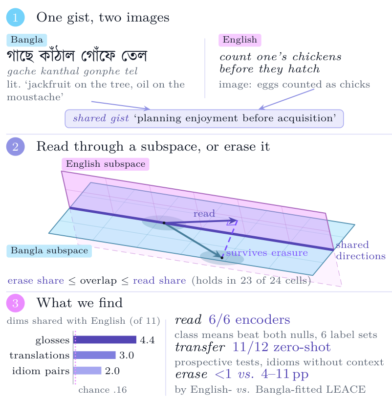
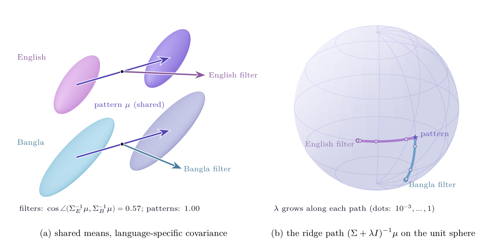
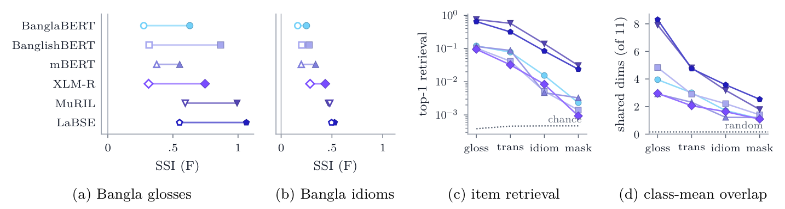
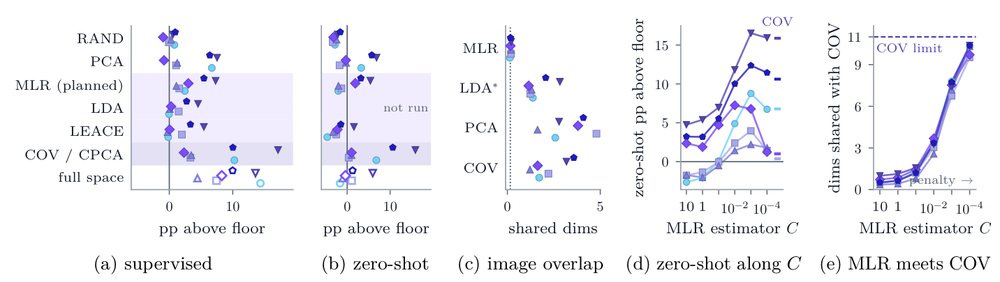
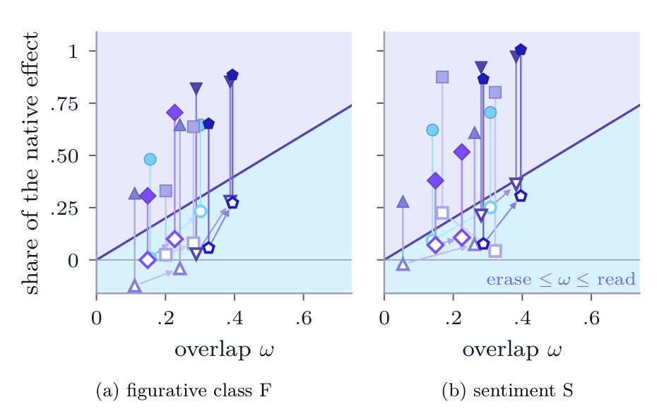

<div align="center">

# Lost in Translation?

### What Cross-Lingual Concept Subspaces Share and Withhold about Bengali Idioms

<a href="#encoders-inputs-and-labels"></a>
<a href="#how-the-measurements-work"></a>
<a href="#experiment-and-artifact-map"></a>
<a href="LICENSE"></a>

</div>

This repository contains the code, frozen analysis plans, aggregate results and human-validation data for the accompanying paper, titled “Lost in Translation? What Cross-Lingual Concept Subspaces Share and Withhold about Bengali Idioms.”

## Overview

Concept-subspace methods estimate the few directions of a representation that carry a concept, read the concept through them, and remove them to erase it. As these tools travel across languages, a tacit assumption travels with them: that a concept fitted in one language is the same object in another. Reading and erasing make different demands on that assumption. A probe succeeds if the fitted directions capture part of the target language's concept; an eraser succeeds only if they contain all of it.

The paper tests the assumption where it is hardest to meet. An idiom's meaning is conventional rather than composed from its words, so an English idiom and its Bangla (Bengali) counterpart share a figurative gist but no surface. On **10,359 Bangla idiom senses** from the Bagdhara corpus, six multilingual and Bangla encoders and seven subspace estimators, it fits concept subspaces on English inputs and asks three things of them on Bangla inputs: whether a Bangla probe can **read** Bangla's figurative classes through them, whether an English classifier **transfers** through them with no Bangla labels, and whether removing them **erases** Bangla's signal. Every readout is tested against random-subspace and permuted-label nulls, and every claim carries an inferential status: confirmatory, prospective, *post hoc* or descriptive.

<p align="center">
  <a href="images/teaser.png">
    
  </a>
  <br>
  <sub><strong>The question and the answer in one picture.</strong> (1) The Bangla <em>gache kanthal gonphe tel</em> (“jackfruit on the tree, oil on the moustache”) and the English <em>count one's chickens before they hatch</em> share a gist but no image. (2) Concept subspaces are estimated from English counterparts (pink) and Bangla idioms are read through them or erased from them. Where the English subspace meets Bangla's class-mean subspace (cyan) only along shared directions (purple), projection keeps part of a Bangla class difference and erasure leaves the rest. (3) The headline numbers. From the paper.</sub>
</p>

## Contents

- [Key findings](#key-findings)
- [How the measurements work](#how-the-measurements-work)
- [Encoders, inputs and labels](#encoders-inputs-and-labels)
- [Results at a glance](#results-at-a-glance)
- [Repository guide](#repository-guide)
- [Using this repository](#using-this-repository)
- [Scope and interpretation](#scope-and-interpretation)
- [Authors](#authors)
- [Citation](#citation)
- [License](#license)

## Key findings

| Finding | Evidence from the paper |
|:---|:---|
| **A planned test finds shared figurative classes in three of six encoders.** | In the single confirmatory family (MLR directions from English counterparts, Bangla idioms in context, 12 tests), English directions recover Bangla's figurative classes beyond both nulls in XLM-R, MuRIL and LaBSE (SSI **0.29**, **0.48** and **0.50**; Holm *p* = .006 against each null) and sentiment in XLM-R (**0.47**): **4 of 12** tests reject. The three figurative effects are **3.0–7.3** accuracy points above a 15.7% floor. *Confirmatory.* |
| **Class-mean directions share more, and more robustly.** | Class-mean (COV) directions beat both nulls in **12 of 12** tests under balanced accuracy, a covariance-matched random null in **12 of 12**, and label-free PCA directions in every cell by **1.5–10.9** points. *Post hoc.* On a second split, under a plan frozen before its outcomes, they replicate for the figurative classes in all **3** nominated encoders. *Prospective, internal: the second split re-partitions the same corpus.* |
| **The idiom alone, without its context, shares its class.** | Under a later plan frozen before its outcomes, English class-mean directions read Bangla idioms in a neutral frame beyond three nulls in **10 of 12** tests, every encoder but mBERT, with a median SSI of **1.03**; English classifiers transfer to them zero-shot in **11 of 12**. *Prospective, internal: on the second split.* |
| **Explicit meaning travels further than idioms.** | On a fixed Bangla target, directions from English glosses read the figurative classes better than directions from idiom counterparts in **6 of 6** encoders on the second split. *Prospective (none of 6 for sentiment).* English and Bangla class-mean subspaces share a median **4.4**, **3.0** and **2.0** of 11 dimensions across encoders when estimated from glosses, translations and idiom pairs (chance **0.16**). *Exploratory.* Directions from the third of English counterparts least like their gloss, mostly conventional idioms, read Bangla's classes less well than random thirds on average in all **12** cells. *Post hoc.* |
| **Patterns transfer zero-shot; filters do not unless penalized.** | On the second split, class-mean (pattern) directions read more than default-penalty MLR (filter) directions in **6 of 6** encoders for the figurative classes and **5 of 6** for sentiment. *Prospective.* Through COV directions, English-trained classifiers applied unchanged to Bangla beat both zero-shot nulls in **8 of 12** tests and keep a median **55%** (figurative classes) and **86%** (sentiment) of the supervised share. Through default-penalty MLR, LEACE or the full space they fall to the floor (median SSI **−0.05**, **−0.13** and **−0.12**). Median zero-shot SSI rises from **0.02** at *C* = 1 to **0.42** at *C* = 10⁻³. *Post hoc.* |
| **Reading does not license erasure.** | English-fitted LEACE removes at most **0.74** points of Bangla figurative-class accuracy, against **4.25–11.03** for Bangla-fitted LEACE, although it removes 0.44–0.82 of the signal from held-out English. INLP removes a median **1.6** points against Bangla's own **8.6**. *Discovery split, descriptive. Prospective on the second split: an English LEACE effect below a quarter of the native one holds in 4 of 6 encoders for the figurative classes and 3 of 6 for sentiment.* R-LACE guards its own language in only **5 of 24** fits, so adversarial erasure remains untested. |
| **Overlap bounds erasure from above and reading from below.** | For Gaussian classes, erase share ≤ overlap ≤ read share (the read/erase bound). The measured shares respect the bound in **11 of 12** encoder × label-set cells, and in **12 of 12** after a rotation fitted on held-out pairs, which raises the overlap and lets erasure transfer. *Post hoc.* |
| **Two volunteers find most classes apt and most counterparts equivalent idioms.** | Cohen's κ is **0.51** for class aptness, **0.63** for function, **0.74** for counterpart kind and **0.40** for counterpart meaning, on 300 TEST items; disagreements were not adjudicated. Items whose counterpart both volunteers judged a conventional idiom are read through English directions **7.3** points less often alone and **6.9** in context, within class. *Descriptive and exploratory; two volunteers.* |

SSI is the share of Bangla's own above-floor accuracy that English directions recover, so its ratios sit beside small absolute effects: a few accuracy points. *Confirmatory*: planned before the campaign. *Prospective*: frozen before the outcomes it tests. *Post hoc*: planned after the discovery results, Holm-corrected within each family. The paper states the evidence and inferential status of every claim.

## How the measurements work

An estimator maps centred English SPACE inputs and their labels to a rank-*M* subspace with orthonormal basis *Q*<sub>e</sub> (rank 11 for the 12 figurative classes, 3 for four-way sentiment). Three operations then use it on Bangla inputs:

| Operation | What is fitted, and where | Measured as |
|:---|:---|:---|
| **Read** | A Bangla-trained L2 logistic probe on Bangla inputs projected onto the English subspace | SSI, below |
| **Transfer** | A probe trained on English inputs through the same subspace, applied unchanged to Bangla; no Bangla label enters | Zero-shot SSI, with the same denominator |
| **Erase** | Remove the English subspace (or Bangla's own) from Bangla inputs and retrain the Bangla probe | Erase share: the accuracy lost to the English eraser over that lost to Bangla's own |
| **Overlap** | Principal angles between the English and Bangla subspaces | ω = ‖*Q*<sub>e</sub><sup>⊤</sup>*Q*<sub>b</sub>‖<sub>F</sub><sup>2</sup>/*M* (chance *M*/*D*) |

$$
\mathrm{SSI}_{e\to b}=\frac{R_{e\to b}-R_0}{R_{b\to b}-R_0}
$$

Here *R*<sub>e→b</sub> is Bangla TEST accuracy through the English subspace and *R*<sub>0</sub> the majority-class floor. The denominator *R*<sub>b→b</sub> reads **Bangla's own subspace from the same estimator**, not the full representation, which it can exceed; SSI is undefined when that native gain is at most 2 points and can exceed 1. Two nulls calibrate every SSI, 1,999 draws each in the planned test: RAND reads Bangla through rank-matched random subspaces, and PERM refits the estimator on labels permuted across input-disjoint components. Robustness tests add a covariance-matched random null (RANDCOV) and label-free PCA directions.

<p align="center">
  <a href="images/patterns-and-filters.png">
    
  </a>
  <br>
  <sub><strong>Patterns are shared where filters are not.</strong> (a) Two languages with the same class-mean difference but language-specific covariance: their discriminative filters differ (cosine 0.57), while the class-mean pattern is identical. (b) As the ridge penalty λ grows, each language's filter moves along the unit sphere towards the shared pattern. From the paper.</sub>
</p>

The seven estimators differ in what they keep. Three formal results organize the measurements rather than add new theory. In the strong-penalty limit, logistic regression's subspace becomes the class-mean pattern. Class-mean coordinates carry no covariance from the fitting language, so they transfer where covariance-weighted ones do not (an application of Aitken's Gauss–Markov theorem). And in the read/erase bound for Gaussian classes, reading needs only an angle while erasure needs containment.

| Estimator | Kind | What the subspace holds |
|:---|:---|:---|
| RAND | Reference | Random orthonormal directions (the grid averages five draws) |
| PCA | Reference | The leading principal directions, no labels |
| MLR | Filter (planned estimator) | The row space of multinomial logistic weights: no intercept, unit-norm rows, as in the reference implementation |
| LDA | Filter | Fisher discriminant directions |
| LEACE | Eraser (oblique map) | COV's class-mean subspace, read through a covariance-weighted map; removing it is the LEACE eraser |
| CPCA | Pattern | Principal directions of the equally weighted class centroids |
| COV | Pattern | Singular directions of the feature–label cross-covariance: the class-mean differences |

## Encoders, inputs and labels

| Encoder | Hugging Face ID | Cross-lingual training signal | Parameters | Layers | Selected layer |
|:---|:---|:---|---:|---:|---:|
| BanglaBERT | `csebuetnlp/banglabert` | Bangla only | 110.0M | 12 | 9 |
| BanglishBERT | `csebuetnlp/banglishbert` | Bangla and English | 110.0M | 12 | 12 |
| mBERT | `bert-base-multilingual-cased` | Monolingual corpora | 177.9M | 12 | 12 |
| XLM-R | `xlm-roberta-large` | Monolingual corpora | 559.9M | 24 | 24 |
| MuRIL | `google/muril-large-cased` | Translation pairs | 505.9M | 24 | 12 |
| LaBSE | `setu4993/LaBSE` | Translation pairs | 470.9M | 12 | 6 |

Parameter counts are backbone parameters, and the selected layer is the one chosen on within-Bangla validation accuracy in the discovery study. The pinned Hub revisions are in [`results/provenance/model_artifacts.json`](results/provenance/model_artifacts.json). A decoder, Qwen3-8B, is analysed on the discovery split only and is exploratory.

Each corpus record yields up to eight inputs, each mean-pooled over its target tokens:

| Input | Text | Pooled over |
|:---|:---|:---|
| `bn-fig` | Bangla example sentence containing the idiom | The idiom span (the planned target) |
| `bn-sentence` | The same sentence | All tokens |
| `bn-context` | The same sentence with the idiom masked | The context tokens |
| `bn-idiom` | The idiom alone in a neutral Bangla frame | The idiom span |
| `bn-para` | Bangla figurative gloss | All tokens |
| `en-idiom` | The first English counterpart in a neutral frame | The counterpart span (the planned source) |
| `en-trans` | English translation of the example sentence | All tokens |
| `en-para` | English figurative gloss | All tokens |

The figurative classes F are a 12-way k-means taxonomy of the English glosses, fitted on SPACE with an encoder that is never probed (`all-MiniLM-L6-v2`); S is the corpus's four-way sentiment. The follow-up experiments add a Bangla-gloss taxonomy, usage domains, re-seeded taxonomies and a tag-built taxonomy. Records are split 40/25/10/25 into SPACE, PROBE, VALIDATION and TEST by input-disjoint components, so no idiom type and no identical model input crosses splits; TEST holds 2,590 records.

## Results at a glance

SSI of English-counterpart directions, by encoder. **Bold** marks tests that beat their nulls after Holm correction.

| Encoder | Planned test, F | Planned test, S | Class means (COV), F | Class means (COV), S | Idiom alone, F | Idiom alone, S |
|:---|:---:|:---:|:---:|:---:|:---:|:---:|
| BanglaBERT | 0.16 | 0.15 | **0.58** | **0.54** | **0.76** | **0.54** |
| BanglishBERT | 0.20 | 0.38 | **0.51** | **0.72** | **1.00** | **1.09** |
| mBERT | 0.20 | 0.40 | **0.53** | **0.38** | 0.85 | 0.59 |
| XLM-R | **0.29** | **0.47** | **0.53** | **0.49** | **1.16** | **1.75** |
| MuRIL | **0.48** | 0.32 | **0.87** | **0.94** | **0.96** | **1.12** |
| LaBSE | **0.50** | 0.30 | **0.73** | **0.94** | **1.06** | **1.31** |

*Planned test*: MLR, accuracy, Bangla idioms in context, discovery split; confirmatory. *Class means*: COV, balanced accuracy, idioms in context, discovery split; each beats RAND, PERM and RANDCOV; *post hoc*. *Idiom alone*: COV, balanced accuracy, idioms in a neutral frame, second split, under its frozen plan; bold beats RAND, PERM and RANDCOV, and mBERT beats RAND and RANDCOV but not PERM; prospective. Each SSI divides by its own estimator's native gain, so only columns of the same estimator compare directly.

<p align="center">
  
  &emsp;
  
  &emsp;
  
  &emsp;
  
  &emsp;
  
  &emsp;
  
  <br>
  <sub>Encoder colours in the figures below. Each encoder also keeps one marker: circle, square, triangle, diamond, inverted triangle and pentagon, in this order.</sub>
</p>

<p align="center">
  <a href="images/explicit-meaning-travels.png">
    
  </a>
  <br>
  <sub><strong>Explicit meaning travels further than idioms.</strong> (a–b) SSI for figurative classes on a fixed Bangla target, from English directions estimated on glosses or translations (filled) or on idiom counterparts (open). (c) Top-1 retrieval of the paired item (log scale; dotted: chance) and (d) dimensions shared by independent English and Bangla class-mean subspaces (of 11; dotted: random) follow the same ladder. Discovery split; exploratory. From the paper.</sub>
</p>

<p align="center">
  <a href="images/estimators-and-penalty.png">
    
  </a>
  <br>
  <sub><strong>Patterns read and transfer; filters do once penalized.</strong> (a) Bangla figurative-class accuracy above the 15.7% floor through English rank-11 directions, read by a Bangla probe (shaded: filters violet, patterns lavender; open markers: full space), and (b) zero-shot by an English probe. (c) Dimensions shared by separately fitted English and Bangla subspaces (dotted: random). (d) Zero-shot accuracy through English MLR directions rises as the penalty grows (<em>C</em> falls), towards COV's (ticks), as (e) the MLR subspace approaches the COV subspace (the strong-penalty limit). Discovery split; exploratory. From the paper.</sub>
</p>

<p align="center">
  <a href="images/read-versus-erase.png">
    
  </a>
  <br>
  <sub><strong>Overlap separates reading from erasure.</strong> Read share (filled; COV SSI) and erase share (open; Bangla accuracy lost by removing the English COV subspace, relative to Bangla's own) against the overlap ω of the two subspaces, before and after (arrows) a rotation fitted on held-out pairs. The read/erase bound places read shares above the diagonal and erase shares below it: 11 of 12 cells comply before rotation, 12 after. (a) Figurative classes, (b) sentiment. Discovery split; <em>post hoc</em>. From the paper.</sub>
</p>

## Repository guide

| Path | Contents |
|:---|:---|
| [`idiom_subspace/`](idiom_subspace/) | The pipeline: corpus loading and input-disjoint splits, taxonomy labels, feature extraction, the seven estimators, the batched GPU probe engine, the studies, inference, progress tracking and the dashboard |
| [`run_research.py`](run_research.py), [`launch_gpu_jobs.py`](launch_gpu_jobs.py), [`dashboard.py`](dashboard.py), [`smoke_offline.py`](smoke_offline.py) | Discovery campaign: one encoder (`run_research.py run`) or all six on one or more GPUs (`launch_gpu_jobs.py`), a read-only localhost monitor, and an offline smoke run |
| [`run_replication.py`](run_replication.py) | The prospective internal replication on split seed 1, under the plan in `configs/plans/` |
| [`run_experiments.py`](run_experiments.py), [`experiments/`](experiments/) | The follow-up experiments X1–X19, with their preflight checks, reproduction gates and verifiers |
| [`analysis/`](analysis/) | Read-only analysis of the campaign, the descriptive synthesis, the taxonomy rebuild, validation-selected MLR, and the human-validation packet and agreement |
| [`configs/`](configs/) | Run profiles; [`configs/plans/`](configs/plans/) holds the three frozen analysis plans, byte for byte as their recorded SHA-256 hashes pin them |
| [`data/`](data/) | How to obtain the corpus, and the two volunteers' annotation sheets |
| [`results/`](results/) | Every aggregate behind the paper's numbers: discovery tables, synthesis, replication, X1–X19, human validation and model provenance |
| [`docs/`](docs/) | [Runbook](docs/RUNNING.md), [experiment protocol](docs/EXPERIMENTS.md), [data audit](docs/DATA_AUDIT.md) and the [equivalence audit](docs/REFERENCE_AUDIT.md) against the reference implementation of the concept-subspace framework |
| [`scripts/`](scripts/) | Bash drivers for the replication and for X1–X19 with their gates |
| [`tests/`](tests/) | Unit and integration tests, plus end-to-end smoke tests of every follow-up experiment on a miniature synthetic campaign |
| [`notebooks/`](notebooks/) | A quick run of the pipeline on Kaggle |
| [`images/`](images/) | Figures from the paper used in this README |

### Experiment and artifact map

| Experiment | Code | Results |
|:---|:---|:---|
| **Discovery campaign** (split seed 0): studies S1–S4 (containment, language, transfer with SSI and nulls, open class and identity), including the planned test | `run_research.py`, `launch_gpu_jobs.py`, `configs/full.json`; `analysis/analyze.py` | [`results/discovery/`](results/discovery/); the planned test in [`primary_confirmatory.csv`](results/discovery/primary_confirmatory.csv) |
| **Descriptive synthesis**: input ladder, estimator families, erasure and class transfer | `analysis/synthesize.py`, `analysis/rebuild_taxonomy.py` | [`results/discovery/synthesis/`](results/discovery/synthesis/) |
| **Prospective internal replication** (split seed 1): E1, the 48-test family of hypotheses H1–H4; E2–E4, mechanism diagnostics | `run_replication.py`, [`configs/plans/FOLLOWUP_PLAN.md`](configs/plans/FOLLOWUP_PLAN.md), `analysis/validation_selected_mlr.py` | [`results/replication/`](results/replication/) |
| **X1** Zero-shot readout | `experiments/x1_zero_shot.py` | [`X1_zero_shot/`](results/experiments/X1_zero_shot/) |
| **X2** Concepts not built from English glosses | `experiments/x2_concepts.py` | [`X2_concepts/`](results/experiments/X2_concepts/) |
| **X3** LEACE ablation | `experiments/x3_leace.py` | [`X3_leace_ablation/`](results/experiments/X3_leace_ablation/) |
| **X4** Pooling-matched design | `experiments/x4_pooling.py` | [`X4_pooling_matched/`](results/experiments/X4_pooling_matched/) |
| **X5** Balanced accuracy and rescored nulls (gate) | `experiments/x5_balanced.py` | [`X5_balanced_metrics/`](results/experiments/X5_balanced_metrics/) |
| **X6** Nonlinear readouts and description length | `experiments/x6_nonlinear.py` | [`X6_nonlinear_mdl/`](results/experiments/X6_nonlinear_mdl/) |
| **X7** Hubness correction and alignment | `experiments/x7_alignment.py` | [`X7_alignment/`](results/experiments/X7_alignment/) |
| **X8** Every cached layer | `experiments/x8_layerwise.py` | [`X8_layerwise/`](results/experiments/X8_layerwise/) |
| **X9** Other erasers and nonlinear leakage | `experiments/x9_erasers.py` | [`X9_erasers_nonlinear/`](results/experiments/X9_erasers_nonlinear/) |
| **X10** Rotations fitted on held-out pairs (gate) | `experiments/x10_heldout_alignment.py` | [`X10_heldout_alignment/`](results/experiments/X10_heldout_alignment/) |
| **X11** Re-seeded and tag-built taxonomies | `experiments/x11_taxonomy.py` | [`X11_taxonomy_robustness/`](results/experiments/X11_taxonomy_robustness/) |
| **X12** Transfer along the penalty path | `experiments/x12_penalty_path.py` | [`X12_penalty_path/`](results/experiments/X12_penalty_path/) |
| **X13** The idiom without its context, *post hoc* | `experiments/x13_idiom_isolated.py` | [`X13_idiom_isolated/`](results/experiments/X13_idiom_isolated/) |
| **X14** The decoder with a powered planned test (not run) | `experiments/x14_decoder.py` | |
| **X15** Covariance-matched null and PCA (gate) | `experiments/x15_matched_nulls.py` | [`X15_matched_nulls/`](results/experiments/X15_matched_nulls/) |
| **X16** The idiom alone, prospectively | `experiments/x16_idiom_prospective.py`, [`configs/plans/PLAN_X16.json`](configs/plans/PLAN_X16.json) | [`X16_idiom_prospective/`](results/experiments/X16_idiom_prospective/) |
| **X17** The volunteers' judgments, item by item | `experiments/x17_human_items.py` | [`X17_human_items/`](results/experiments/X17_human_items/) |
| **X18** Intervals that refit the subspaces | `experiments/x18_refit_bootstrap.py` | [`X18_refit_bootstrap/`](results/experiments/X18_refit_bootstrap/) |
| **X19** Which counterparts carry the signal | `experiments/x19_counterpart_type.py` | [`X19_counterpart_type/`](results/experiments/X19_counterpart_type/) |
| **Human validation**: packet, agreement and class summaries | `analysis/human_validation_packet.py`, `analysis/human_validation.py` | [`data/human_validation/`](data/human_validation/), [`results/human_validation/`](results/human_validation/) |

The X folders sit in [`results/experiments/`](results/experiments/), whose README lists every file.

## Using this repository

### Inspect the released results

The results are plain CSV and JSON, so the paper's numbers can be checked without a GPU, the corpus or model weights:

```python
import pandas as pd

planned = pd.read_csv("results/discovery/primary_confirmatory.csv")
print(planned[["model", "concept", "R_ep", "R_pp", "R0", "SSI", "ci_lo", "ci_hi"]])
# R_ep: Bangla TEST accuracy through English directions; R_pp: through Bangla's own; R0: the majority floor
```

### Set up the environment

Python 3.10 or later, with a CUDA build of PyTorch for real runs (the tests need only the CPU):

```bash
pip install torch                       # choose the build for your CUDA version
pip install -r requirements.txt         # includes the pinned BanglaBERT normalizer from GitHub
python -m pytest -q                     # unit tests and the smoke tests of X1–X19; no downloads
```

### Reproduce the analyses from the released tables

Two analyses run from the released files alone and reproduce their outputs:

```bash
python analysis/synthesize.py           # results/discovery/synthesis/ (figures go to analysis/figures/)
python analysis/human_validation.py     # agreement and class summaries in results/human_validation/
```

### Rerun the experiments

The full pipeline needs the Bagdhara corpus (see [`data/README.md`](data/README.md)) and one 24 GB GPU; the six-encoder discovery phase took about 6 hours on an RTX 3090. [`docs/RUNNING.md`](docs/RUNNING.md) gives every command. In outline:

```bash
# CAMPAIGN/configs/full_3090.json is configs/full.json with the GPU paths enabled (docs/RUNNING.md derives it)
python run_research.py audit --config configs/full.json --data /path/to/bagdhara.json --out CAMPAIGN/audit
python launch_gpu_jobs.py --config CAMPAIGN/configs/full_3090.json --data /path/to/bagdhara.json \
    --out CAMPAIGN/primary --gpus 0 --probe-backend torch
IDIO_CAMPAIGN=CAMPAIGN python analysis/analyze.py
bash scripts/run_replication.sh CAMPAIGN
bash scripts/run_experiments.sh CAMPAIGN OUT
```

Each experiment group starts with a reproduction gate (X5, X10 and X15) that must reproduce the released numbers before the group's other results are trusted, and X16 refuses to run if its frozen plan has changed.

## Scope and interpretation

- **One language pair, one resource.** The study covers Bangla and English, one export of one idiom resource and linear subspaces. The propositions do not depend on Bangla, but the measured magnitudes, the encoder ranking and the size of the read–erase gap may differ elsewhere.
- **The replication is internal.** The second split re-partitions the same records: 932 of its 2,590 TEST items were also discovery TEST items, and the rest served in other roles. Its plans were frozen in the repository rather than publicly preregistered, and the idiom-alone plan was written after the discovery results for its target were known.
- **Robustness families are *post hoc*.** Each is Holm-corrected within itself, not across families. Intervals that refit the estimators and probes are a median 1.8 times as wide as the published ones, so encoder rankings are descriptive.
- **F is one machine-built partition of coarse meaning.** It clusters English glosses, and a re-seed moves much of it (ARI 0.40–0.63), which changes which encoders pass the planned MLR test, though not the class-mean result. Sentiment labels were drafted by LLMs before experts validated or replaced them.
- **The human check is small.** Two volunteers judged 300 items in spreadsheets without session records; agreement on class aptness and counterpart meaning is moderate and fair (κ 0.51 and 0.40), and disagreements were not adjudicated.
- **Zero-shot readouts still use unlabelled Bangla data.** Bangla inputs are centred on their own unlabelled SPACE mean; centring them on the English mean instead leaves 6 of 12 COV tests significant.
- **Erasure is tested only for linear readouts.** MLP probes still read 5.5–5.6 points above the floor after Bangla's own linear erasers, and R-LACE guarded its own language in only 5 of 24 fits.
- **Contexts are unusually informative.** The corpus's example sentences were written to illustrate their idioms; the idiom-alone condition strips that context away, but naturalistic occurrences remain untested.
- **The propositions idealize.** They assume Gaussian classes, isotropic noise or exactly shared means, and explain orderings rather than predict magnitudes.

See the paper's discussion of its limitations for the full account.

## Authors

Withheld for anonymity.

## Citation

Citation details will be added once the paper is de-anonymized.

## License

The code is released under the [MIT License](LICENSE). Files that quote text from the Bagdhara corpus, namely the annotation sheets in [`data/human_validation/`](data/human_validation/) and the six illustrative records in [`results/discovery/illustrative_cases.csv`](results/discovery/illustrative_cases.csv), are distributed under the corpus's [CC BY-SA 4.0](https://creativecommons.org/licenses/by-sa/4.0/) license, with attribution to [Sakhawat et al. (2026)](https://aclanthology.org/2026.lrec-1.546/). The corpus itself is not redistributed. The pinned models keep their own licenses, listed in [`results/provenance/`](results/provenance/).
